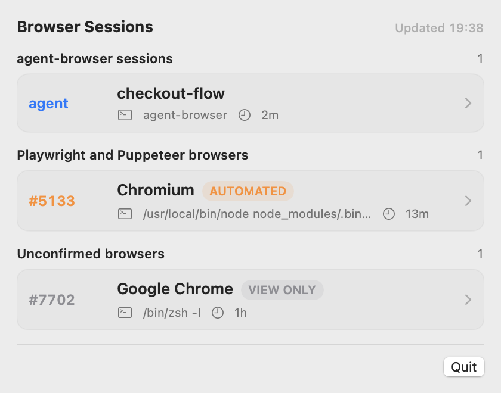

# Browser Sessions

A macOS menu bar app that lists the automation browsers running on your Mac and lets you close them. It finds agent-browser sessions and the Chrome or Chromium instances that Playwright and Puppeteer start.


The menu bar shows how many browsers are running. The icon hides when there are none.

<picture>
  <source media="(prefers-color-scheme: dark)" srcset="docs/images/popover-dark.png">
  
</picture>

## How it finds browsers

- It reads your own processes through libproc, every 5 seconds. It never reads their environment variables.
- Each browser gets one row. Renderer, GPU and other helper processes are skipped.
- A browser counts as Playwright or Puppeteer when its arguments show it: `--remote-debugging-pipe`, a Playwright profile, or a Puppeteer path with `--enable-automation`. A browser with only `--remote-debugging-port` or `--headless` is listed as unconfirmed and can't be closed from the app.
- agent-browser sessions come from `agent-browser session list`. The app runs it only when an agent-browser daemon starts or stops.

Close asks for confirmation. It ends agent-browser sessions with `agent-browser close`. Other browsers get SIGTERM, after the app checks that the PID still belongs to the same browser.

## Build and run

Requires macOS 14 and the Xcode Command Line Tools. agent-browser is optional.

```bash
cd BrowserSessions
swift run BrowserSessionsTestRunner   # run the tests
./scripts/install-app.sh              # build and copy to /Applications
```

`./restart-app.sh` in the repo root rebuilds, reinstalls and relaunches the app. `BROWSER_SESSIONS_STUB_COUNT=3 ./scripts/run-app.sh` shows a fake count. Manual UI checks are in `docs/qa/manual-ae-checklist.md`.
