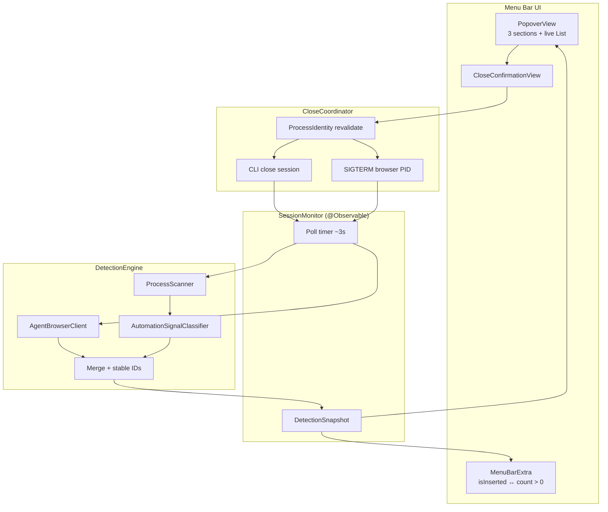

# feat: Automation Browser Menu Bar App

## Summary

Build a native macOS 14+ menu bar accessory app in Swift/SwiftUI that polls every few seconds for `agent-browser` sessions and Playwright/Puppeteer-like Chrome processes, shows a count when anything is detected (or a neutral zero-state when empty), renders a three-tier live-updating popover, and supports confidence-gated individual close actions with confirmation and PID revalidation. Implementation follows the origin requirements doc; this plan resolves the deferred technical questions (CLI contract, signal table, permissions, hide fallback, identity tuple) and sequences the greenfield scaffold into testable units.

---

## Problem Frame

Agents leave automation browsers running in the background. The user currently has to remember that a browser may exist and manually inspect terminals or process lists. This plan implements the supervision utility defined in the origin document so the user can see what exists and safely close known or high-confidence leftovers from the menu bar.

---

## Requirements

- Satisfy origin requirements **R1–R23** and flows **F1–F6**, verified against acceptance examples **AE1–AE13**.
- Resolve origin planning questions: v1 signal table, permissions/degradation, hide vs zero-state, `agent-browser` CLI contract, PID revalidation tuple.
- Deliver a greenfield Xcode project with unit tests for detection logic and manual QA coverage for menu bar/popover lifecycle.

**Origin actors:** A1 (User), A2 (`agent-browser` session), A3 (Possible automation browser), A4 (macOS platform)

**Origin flows:** F1 (Menu bar visibility), F2 (Inspect live sessions), F3 (Close an entry), F4 (First launch and permissions), F5 (Zero-state fallback), F6 (Popover lifecycle)

**Origin acceptance examples:** AE1–AE13 (see Implementation Units for traceability)

---

## Scope Boundaries

- Bulk close, stale/abandoned labels, ignore rules, dashboard integration, launch-at-login, and killing owning Node/test processes remain out of v1 (see origin Scope Boundaries).
- Tab URL/title via CDP or Accessibility for Playwright/Puppeteer browsers is **not** in v1; last-change age for those rows defaults to unknown unless cheaply available later.
- App Sandbox is disabled for v1 so process enumeration and subprocess CLI calls work without entitlement fights. v1 ships **unsigned/local-only**; detection and close actions must sit behind injectable protocols so a privileged helper (XPC/SMJobBless) can replace in-process implementations later without rewriting UI.

### Deferred to Follow-Up Work

- **Privileged helper tool** for sandboxed/notarized distribution: swap protocol implementations once v1 architecture proves out (Proof review 2026-06-21).
- **Launch-at-login (`SMAppService`)**: obvious v1.1 enhancement (origin R23).
- **CDP metadata reader** for PW/PP last-change age: separate unit after v1 ships if Accessibility/CDP proves worthwhile.
- **`AGENTS.md` at repo root**: create during U1 scaffold or immediately after; not blocking plan approval.

---

## Context & Research

### Relevant Code and Patterns

- Greenfield repo — no existing application code. Only `docs/brainstorms/2026-06-21-automation-browser-menu-bar-requirements.md`.
- Target stack: Swift 6, SwiftUI `MenuBarExtra`, `.menuBarExtraStyle(.window)` for live popover refresh (`.menu` style blocks runloop and breaks R7a).

### Institutional Learnings

- No `docs/solutions/` in this repo yet.
- Discrete confidence tiers (HIGH vs LOW) preferred over continuous scores — maps directly to origin R2b/R8b.

### External References

- [MenuBarExtra](https://developer.apple.com/documentation/SwiftUI/MenuBarExtra) — `isInserted` for hide when count is zero
- [Apple QA1123](https://developer.apple.com/library/archive/qa/qa2001/qa1123.html) — process enumeration via `sysctl`
- [MenuBarExtraAccess](https://github.com/orchetect/MenuBarExtraAccess) — optional helper for popover present/dismiss and `NSStatusItem.isVisible` observation
- [getargv.swift](https://github.com/getargv/getargv.swift) — reliable `KERN_PROCARGS2` parsing (avoid hand-rolled argv bugs)
- Verified locally: `agent-browser` v0.28.0 at `/opt/homebrew/bin/agent-browser`

---

## Key Technical Decisions

- **SwiftUI + AppKit hybrid, macOS 14+ deployment target**: Native menu bar utility; `LSUIElement = true` (no Dock icon). (see origin: visibility-first supervision use case)
- **`MenuBarExtra` with `.window` style**: Required for live list refresh (R7a), keyboard rows, and confirmation UI; `.menu` style is rejected.
- **Hide via `isInserted` binding**: `isInserted = totalCount > 0`. If hide is unreliable on a target OS version, fall back to neutral zero-state (R5a) using dim icon + empty popover — never show numeric `0`.
- **Polling orchestrator as `@Observable SessionMonitor`**: Timer every **3 seconds** (within R7 “every few seconds”); injected via `.environment()` into popover; runs regardless of popover open state.
- **Process args via `getargv` or carefully tested `KERN_PROCARGS2` wrapper**: Required for Playwright/Puppeteer cmdline fingerprinting; hand-rolled parsers are a known misclassification risk.
- **No App Sandbox v1; unsigned/local-only distribution**: Same-user process inspection and subprocess CLI run in-process for v1. `AgentBrowserClient`, `ProcessScanner`, and `ProcessKiller` are protocol-backed so a future privileged helper can replace them without UI changes (Proof review 2026-06-21).
- **`agent-browser` integration uses global `--session` flag before subcommand**:
  - List: `agent-browser session list --json` → `{"success":true,"data":{"sessions":["name",...]}}`
  - Close: `agent-browser --session <name> close --json` → `{"success":true,"data":{"closed":true}}`
  - **Do not use** `agent-browser close --session <name>` — verified incorrect flag order.
  - Subprocess timeout **2s**; failures degrade to zero known sessions for that poll (R1a, R19).
- **URL for known sessions**: `session list --json` returns names only; optional per-session `agent-browser --session <name> get url --json` with caching — only fetch URLs for listed sessions when popover is open or on demand to limit N+1 cost.
- **v1 signal table (HIGH = closable, LOW = inspect-only)**: see High-Level Technical Design below; satisfies origin R2/R2b deferred question.
- **PID revalidation tuple before kill**: PID exists; start time unchanged within ±2s; executable basename unchanged; cmdline still contains ≥1 signal token used at classification time. Abort kill on mismatch (R13a).
- **Stable row identity**: `sha256(source + sessionName)` for known sessions; `sha256("pid:" + pid + startTime + signalHash)` for process rows — enables in-place popover updates and focus restoration (R16a).
- **Accessibility for URL/title reads deferred**: v1 shows unknown last-change age for PW/PP rows; F4 onboarding explains process inspection only unless Accessibility is added in follow-up.
- **Visibility over confidence (Proof review 2026-06-21)**: Prefer showing more candidate processes in the popover and count, even when classification is weak. Err toward inclusive LOW-tier listing; keep destructive close gated on HIGH/known only.
- **Integration tests for real tool usage (Proof review 2026-06-21)**: Beyond unit tests with fixtures, add opt-in integration tests that invoke the real `agent-browser` CLI (when installed) and verify exact subprocess argv for list/close; add integration coverage for PID kill paths using a spawned test subprocess, not live user browsers.

---

## Open Questions

### Resolved During Planning

- **v1 signal table (origin R2/R2b)**: Defined in High-Level Technical Design; HIGH requires framework-specific markers, not generic `--remote-debugging-port` alone.
- **`agent-browser` CLI (origin R12)**: Verified commands and JSON shapes above; close uses `--session <name>` global flag.
- **Permissions (origin R8/R17/R18)**: Process list + cmdline via sysctl/proc APIs needs no TCC for same-user processes; Accessibility optional and out of v1 scope for PW/PP URL reads.
- **Hide vs zero-state (origin R5/R5a)**: Use `isInserted`; neutral zero-state is required fallback, not optional; validate on macOS 14–16 during U1 QA spike.
- **PID revalidation tuple (origin R13a)**: PID + start time ±2s + cmdline signal match; documented in Key Technical Decisions.
- **Sandbox / distribution (Proof review)**: v1 unsigned/local-only; helper-tool swap path required in architecture.
- **Signal table posture (Proof review)**: visibility over confidence — inclusive LOW listing accepted.
- **Manual QA artifact (Proof review)**: add `docs/qa/manual-ae-checklist.md`; implementing agent must flag user when manual steps are required.

### Deferred to Implementation

- Exact zero-state icon/visual treatment (dim globe vs custom template) — choose during UI polish in U5.
- Whether to add `MenuBarExtraAccess` SPM dependency or wire minimal AppKit introspection manually — decide during U1 spike based on Escape/focus behavior.
- Per-session URL fetch concurrency limit — tune after measuring poll latency with multiple `agent-browser` sessions.

---

## Output Structure

```
BrowserSessions/
├── BrowserSessions.xcodeproj
├── BrowserSessions/
│   ├── App/
│   │   ├── BrowserSessionsApp.swift
│   │   └── SessionMonitor.swift
│   ├── Detection/
│   │   ├── AgentBrowserClient.swift
│   │   ├── ProcessScanner.swift
│   │   ├── ProcessArguments.swift
│   │   ├── AutomationSignalClassifier.swift
│   │   └── DetectionEngine.swift
│   ├── Actions/
│   │   ├── CloseCoordinator.swift
│   │   └── ProcessKiller.swift
│   ├── Models/
│   │   ├── DetectedEntry.swift
│   │   ├── ConfidenceTier.swift
│   │   ├── DetectionSnapshot.swift
│   │   └── ProcessIdentity.swift
│   ├── UI/
│   │   ├── PopoverView.swift
│   │   ├── EntryRowView.swift
│   │   ├── ZeroStateView.swift
│   │   ├── CloseConfirmationView.swift
│   │   └── PermissionsOnboardingView.swift
│   ├── Support/
│   │   ├── CommandRunner.swift
│   │   └── URLSanitizer.swift
│   └── Resources/
│       └── Info.plist
├── BrowserSessionsTests/
│   ├── AutomationSignalClassifierTests.swift
│   ├── AgentBrowserClientTests.swift
│   ├── ProcessIdentityTests.swift
│   └── Fixtures/
│       └── CmdlineFixtures.swift
├── docs/
│   ├── brainstorms/
│   │   └── 2026-06-21-automation-browser-menu-bar-requirements.md
│   └── plans/
│       └── 2026-06-21-001-feat-automation-browser-menu-bar-plan.md
├── docs/
│   └── qa/
│       └── manual-ae-checklist.md
└── AGENTS.md
```

---

## High-Level Technical Design

> *This illustrates the intended approach and is directional guidance for review, not implementation specification. The implementing agent should treat it as context, not code to reproduce.*



### v1 automation browser signal table

**Process filter (visibility-first):** Classify processes whose executable basename is one of `Google Chrome`, `Chromium`, `Chrome`, `Microsoft Edge`, or whose path contains `ms-playwright`. When in doubt after passing the browser-family filter, prefer listing as **LOW (inspect-only)** rather than omitting. Exclude `chrome_crashpad_handler` and other non-browser helper processes only — not Electron/renderer children that may look like automation.

| Tier | Rule | Example match | Example false positive |
| --- | --- | --- | --- |
| **HIGH (closable)** | Path under `~/Library/Caches/ms-playwright/` or `ms-playwright` in executable | Playwright bundled Chromium | Dev manually using Playwright flags |
| **HIGH** | Cmdline contains `--remote-debugging-pipe` | Default Playwright launch | Rare manual Chrome with same flag |
| **HIGH** | Cmdline contains `playwright` profile dir markers (`playwright_chromiumdev_profile`, etc.) | Playwright temp profile | — |
| **HIGH** | Parent process cmdline matches `playwright`, `@playwright/test`, or `playwright-core` | PW test runner child browser | — |
| **HIGH** | Puppeteer cache path in executable **and** `--enable-automation` | Puppeteer bundled Chrome | — |
| **HIGH** | Parent cmdline contains `puppeteer` | Puppeteer script child | — |
| **LOW (inspect-only)** | `--remote-debugging-port=` **without** HIGH markers | Manual DevTools debugging | Common dev workflow |
| **LOW** | `--headless` / `--headless=new` without HIGH markers | CI headless Chrome | Background scripts |
| **LOW** | `--user-data-dir` in `/tmp` without PW/PP fingerprints | Ephemeral Chrome | Electron-adjacent apps |
| **LOW** | Chrome/Chromium with no HIGH signals and no PW/PP parent | Unknown automation-looking browser | Regular Chrome with odd flags |

**Classification:** Any matching HIGH rule → closable tier. Otherwise if process passes browser filter → inspect-only tier (**visibility over confidence** — more LOW rows is acceptable in v1). Known `agent-browser` sessions always appear in **Known sessions** (not PW/PP tiers) even if the underlying process would match LOW signals.

### Metadata population (v1)

| Field | Known session | HIGH PW/PP | LOW possible |
| --- | --- | --- | --- |
| URL/domain | `get url --json` when popover open / cached | Domain from AX/CDP if ever added; else unknown | Usually unknown |
| Last-change age | Diff cached URL across polls | Unknown in v1 | Unknown |
| Process age | From process start time when PID known | Required | Required |
| Cmdline slice | Bounded ~120 chars, sanitized | Required | Required |

---

## Implementation Units

### U1. Xcode scaffold and menu bar shell

**Goal:** Create the macOS accessory app with `MenuBarExtra`, polling timer skeleton, and hide/zero-state/count binding.

**Requirements:** R5, R5a, R6, R6a, R7, R20, R23; F1, F5; Covers AE3, AE10

**Dependencies:** None

**Files:**
- Create: `BrowserSessions/BrowserSessions.xcodeproj`, `BrowserSessions/BrowserSessions/App/BrowserSessionsApp.swift`, `BrowserSessions/BrowserSessions/App/SessionMonitor.swift`, `BrowserSessions/BrowserSessions/Models/DetectionSnapshot.swift`, `BrowserSessions/BrowserSessions/Resources/Info.plist`, `AGENTS.md`, `README.md`
- Test: `BrowserSessionsTests/SessionMonitorTests.swift`

**Approach:**
- `LSUIElement = YES`, deployment target macOS 14.
- `MenuBarExtra` with `.menuBarExtraStyle(.window)`.
- Bind `isInserted` to `snapshot.totalCount > 0`; when false but hide fails QA, show neutral zero-state view (dim icon, no badge).
- `SessionMonitor` owns timer and publishes empty snapshot until detectors land in U3/U4.
- Manual QA spike: verify hide behavior on macOS 14+; document chosen zero-state visual.

**Patterns to follow:**
- Origin metadata contract section structure for future UI tiers.

**Test scenarios:**
- Happy path: `totalCount = 0` → `isInserted == false` (or zero-state flag set when hide unsupported).
- Happy path: `totalCount = 3` → menu label shows `3`; `101` → `99+`.
- Edge case: count transitions `1 → 0` on poll → hide or zero-state activates.
- Integration: timer fires while app running → snapshot timestamp updates.

**Verification:**
- App launches as menu bar only (no Dock icon).
- Empty detection shows hidden or neutral zero-state per R5/R5a.
- Nonzero stub count shows badge.

---

### U2. `agent-browser` CLI client

**Goal:** Detect and close named `agent-browser` sessions via subprocess with JSON parsing, timeouts, and graceful degradation.

**Requirements:** R1, R1a, R12, R19; F4 (partial); Covers AE5, AE11

**Dependencies:** U1

**Files:**
- Create: `BrowserSessions/BrowserSessions/Detection/AgentBrowserClient.swift`, `BrowserSessions/BrowserSessions/Support/CommandRunner.swift`, `BrowserSessions/BrowserSessions/Models/DetectedEntry.swift`
- Test: `BrowserSessionsTests/AgentBrowserClientTests.swift`, `BrowserSessionsTests/Fixtures/AgentBrowserJSONFixtures.swift`, `BrowserSessionsTests/AgentBrowserClientIntegrationTests.swift` (opt-in when `agent-browser` on PATH)

**Approach:**
- Define `AgentBrowserClientProtocol` for helper-tool swap later.
- `CommandRunner` wraps `Process` with 2s timeout, captures stdout/stderr, never crashes on non-zero exit.
- `listSessions()` → parse `data.sessions` string array; optional `getURL(session:)` using `--session <name> get url --json`.
- `closeSession(name:)` → `agent-browser --session <name> close --json`.
- Return typed result: `.available([DetectedEntry])`, `.unavailable(reason)`, `.error(message)` for degradation banner.

**Execution note:** Start with failing unit tests for JSON parse shapes and flag order before wiring live CLI in integration manual tests.

**Test scenarios:**
- Happy path: valid list JSON with two session names → two known entries.
- Happy path: close success JSON → `.success`.
- Error path: malformed JSON → `.error`, no crash.
- Error path: CLI not on PATH → `.unavailable`.
- Error path: subprocess timeout → treat as unavailable for poll.
- Integration: mock `CommandRunner` returns fixture JSON; client produces stable session IDs.
- Integration (opt-in): when `agent-browser` installed, `listSessions`/`closeSession` use exact argv `agent-browser --session <name> close --json` (never `close --session`).

**Verification:**
- Matches verified CLI contract in Key Technical Decisions.
- Degraded state surfaced when CLI missing (feeds U5 banner).

---

### U3. Process scanner and signal classifier

**Goal:** Enumerate Chrome/Chromium processes, parse cmdlines reliably, and assign HIGH vs LOW confidence tiers.

**Requirements:** R2, R2a, R2b, R8, R8a, R13a (identity tuple); Covers AE2, AE7, AE13

**Dependencies:** U1

**Files:**
- Create: `BrowserSessions/BrowserSessions/Detection/ProcessScanner.swift`, `BrowserSessions/BrowserSessions/Detection/ProcessArguments.swift`, `BrowserSessions/BrowserSessions/Detection/AutomationSignalClassifier.swift`, `BrowserSessions/BrowserSessions/Models/ProcessIdentity.swift`, `BrowserSessions/BrowserSessions/Models/ConfidenceTier.swift`, `BrowserSessions/BrowserSessions/Support/URLSanitizer.swift`
- Test: `BrowserSessionsTests/AutomationSignalClassifierTests.swift`, `BrowserSessionsTests/ProcessIdentityTests.swift`, `BrowserSessionsTests/Fixtures/CmdlineFixtures.swift`

**Approach:**
- `ProcessScanner` lists candidate PIDs via `sysctl(KERN_PROC_ALL)` filtered to browser basenames.
- `ProcessArguments` wraps getargv or tested `KERN_PROCARGS2` parser.
- `AutomationSignalClassifier` implements signal table from High-Level Technical Design; pure function for testability.
- `ProcessIdentity` stores pid, startTime, executable, signalTokens for revalidation.
- `URLSanitizer` strips query params and prefers domain for display.

**Execution note:** Implement classifier test-first with fixture cmdlines copied from real Playwright launches and Electron false positives.

**Test scenarios:**
- Covers AE13. HIGH: Playwright cmdline with `--remote-debugging-pipe` → closable tier.
- Covers AE7. LOW: `--remote-debugging-port=9222` only → inspect-only tier.
- Happy path: Puppeteer parent chain → HIGH.
- Edge case: `chrome_crashpad_handler` → excluded entirely.
- Edge case: regular Chrome with no signals → not listed (or LOW if browser filter passes — document chosen behavior in classifier).
- Error path: `ProcessIdentity.matches(current:)` false when start time drift > 2s → revalidation fails.
- Integration: scanner + classifier together produce `DetectedEntry` with stable ID.

**Verification:**
- Classifier tests cover all HIGH and LOW rules with at least one fixture each.
- Identity tuple fields populated for every process row.

---

### U4. Detection engine merge and live snapshot

**Goal:** Combine known sessions and classified processes into one snapshot driving menu count and popover; support in-place diff by stable row ID.

**Requirements:** R3, R3a, R7, R7a, R9, R9a, R15; F1, F6; Covers AE1, AE4, AE12

**Dependencies:** U2, U3

**Files:**
- Create: `BrowserSessions/BrowserSessions/Detection/DetectionEngine.swift`
- Modify: `BrowserSessions/BrowserSessions/App/SessionMonitor.swift`, `BrowserSessions/BrowserSessions/Models/DetectionSnapshot.swift`
- Test: `BrowserSessionsTests/DetectionEngineTests.swift`

**Approach:**
- Run `AgentBrowserClient` and `ProcessScanner` concurrently each poll.
- Dedupe: if session maps to PID also classified as LOW, prefer **Known sessions** row.
- Compute `totalCount`, section buckets, optional degraded banner from CLI state.
- Track last URL per known session to derive last-change age (R9a).
- Diff entries by stable ID for popover row reuse (R7a).

**Test scenarios:**
- Covers AE1. Two known + one HIGH process → `totalCount == 3`.
- Covers AE4. Old process with no URL changes → last-change unknown, no stale label.
- Covers AE12. Last entry removed while snapshot updating → `totalCount == 0`.
- Edge case: CLI unavailable but processes detected → count includes processes only + degraded flag.
- Integration: poll updates snapshot timestamp and preserves unchanged row IDs.

**Verification:**
- `SessionMonitor` publishes merged snapshot every ~3s.
- Count includes LOW entries (R3) but sections separate closable vs inspect-only.

---

### U5. Popover UI — three tiers, live refresh, zero/empty states

**Goal:** Render the supervision popover with three sections, visible confidence labels, live updates, keyboard/VoiceOver support, and empty/zero states.

**Requirements:** R4, R4a, R8, R8b, R10, R16, R21, R22; F2, F5, F6; Covers AE2, AE3, AE4, AE7, AE9, AE10, AE12

**Dependencies:** U4

**Files:**
- Create: `BrowserSessions/BrowserSessions/UI/PopoverView.swift`, `BrowserSessions/BrowserSessions/UI/EntryRowView.swift`, `BrowserSessions/BrowserSessions/UI/ZeroStateView.swift`
- Modify: `BrowserSessions/BrowserSessions/App/BrowserSessionsApp.swift`
- Test: `BrowserSessionsTests/PopoverViewModelTests.swift` (pure section grouping logic if extracted)

**Approach:**
- `List` with three sections matching origin R4 labels.
- Row shows metadata per origin contract table; confidence badge on possible rows (R8b).
- Bind to `SessionMonitor.snapshot`; rows keyed by stable ID.
- Zero-state popover when count 0 but item visible (R5a); empty-state message when last row disappears while open (R21).
- `.onExitCommand` dismisses popover (R22); accessibility labels include closable vs inspect-only (R16).
- Optional non-blocking note when count > 0 but zero closable rows (R3a).

**Test scenarios:**
- Covers AE2. Known + HIGH + LOW rows render in correct sections with badges.
- Covers AE7. LOW row has no Close button.
- Covers AE9. Accessibility label includes PID and inspect-only state for LOW row.
- Covers AE10. Zero-state shows no numeric count in menu bar.
- Covers AE12. Empty state when last entry gone while popover open.
- Edge case: live poll updates row count without closing popover (manual QA + view model test for section counts).

**Verification:**
- Manual QA: popover updates within one poll interval while held open.
- Keyboard navigation reaches rows and dismisses with Escape.

---

### U6. Close flow with confirmation and PID revalidation

**Goal:** Implement confidence-gated close for known sessions and HIGH processes with confirmation, stale-target handling, and safe kill.

**Requirements:** R11, R11a, R12, R13, R13a, R14, R14a, R14b, R14c, R15, R16a; F3, F6; Covers AE5, AE6, AE8

**Dependencies:** U2, U3, U5

**Files:**
- Create: `BrowserSessions/BrowserSessions/Actions/CloseCoordinator.swift`, `BrowserSessions/BrowserSessions/Actions/ProcessKiller.swift`, `BrowserSessions/BrowserSessions/UI/CloseConfirmationView.swift`
- Modify: `BrowserSessions/BrowserSessions/UI/PopoverView.swift`, `BrowserSessions/BrowserSessions/App/SessionMonitor.swift`
- Test: `BrowserSessionsTests/CloseCoordinatorTests.swift`, `BrowserSessionsTests/ProcessKillerTests.swift`, `BrowserSessionsTests/ProcessKillerIntegrationTests.swift` (spawned test subprocess)

**Approach:**
- Define `ProcessKillerProtocol` for helper-tool swap later.
- Close button only on known and HIGH rows (R11/R11a).
- Confirmation shows consequence text per entry type (session close vs PID kill).
- On confirm: revalidate `ProcessIdentity` for PID kills; call `AgentBrowserClient.closeSession` for known entries.
- `ProcessKiller` sends SIGTERM to browser PID only (R13).
- On cancel, identity change, or failure → R14a/R14b/R14c paths; always trigger full refresh afterward (R15).
- Restore keyboard focus to same row ID if still present else next row / menu bar (R16a).

**Test scenarios:**
- Covers AE5. Confirm close on known session → client close invoked → refresh triggered.
- Covers AE6. Confirm close on HIGH PID → revalidate → SIGTERM → refresh.
- Covers AE8. Cancel confirmation → no close invoked.
- Covers AE8. Entry disappears during dialog → non-destructive outcome + refresh.
- Error path: revalidation fails (start time changed) → abort kill, show error status.
- Error path: close JSON returns failure → R14b message.
- Integration: kill targets only the spawned test PID; revalidation aborts when start time/cmdline drift.

**Verification:**
- No Close affordance on LOW rows.
- Kill never targets parent Node/test process.

---

### U7. First-launch permissions onboarding, manual QA checklist, and degradation UX

**Goal:** Explain process inspection on first launch, surface reduced capability when CLI or metadata reads fail, and ship a manual QA checklist that prompts the user when automation cannot verify UI behavior.

**Requirements:** R17, R18; F4; Covers AE11; Proof review manual QA artifact

**Dependencies:** U5, U6

**Files:**
- Create: `BrowserSessions/BrowserSessions/UI/PermissionsOnboardingView.swift`, `docs/qa/manual-ae-checklist.md`
- Modify: `BrowserSessions/BrowserSessions/App/BrowserSessionsApp.swift`, `BrowserSessions/BrowserSessions/UI/PopoverView.swift`, `README.md`, `AGENTS.md`
- Test: `BrowserSessionsTests/DegradationBannerTests.swift`

**Approach:**
- `Settings` scene (or one-time sheet) explains why the app reads local process metadata (R17).
- Popover banner when `AgentBrowserClient` unavailable or partial detection (R18, R1a).
- Do not request Accessibility in v1 unless cheap URL reads are added; document in onboarding that PW/PP URLs may be unknown.
- `docs/qa/manual-ae-checklist.md` maps AE1–AE13 to step-by-step manual checks (menu bar hide, live popover refresh, close confirmation, keyboard/VoiceOver spot checks).
- **Implementing-agent rule:** after U5/U6 land, explicitly notify the user which checklist sections require manual verification before calling v1 complete.

**Test scenarios:**
- Covers AE11. CLI missing → banner visible in popover; process rows still appear when detectable.
- Happy path: first launch flag shows onboarding once.
- Edge case: CLI recovers next poll → banner clears.

**Verification:**
- App never crashes on denied/missing capabilities.
- Onboarding copy matches actual v1 permissions (process inspection only).

---

## System-Wide Impact

- **Interaction graph:** `SessionMonitor` timer is the single poll entry point; UI reads snapshot only; `CloseCoordinator` is the only mutation path besides timer refresh.
- **Error propagation:** Detector failures produce degraded flags on snapshot, not thrown errors across UI layers.
- **State lifecycle risks:** Stable row IDs prevent focus loss during live refresh; confirmation dialog must subscribe to snapshot updates for R14c.
- **Integration coverage:** Opt-in integration tests cover CLI argv and PID kill mechanics; `docs/qa/manual-ae-checklist.md` covers AE1–AE13 UI behavior the implementer must ask the user to run manually.
- **Unchanged invariants:** Does not manage agent harness processes, Playwright test runners, or non-browser automation; does not persist sensitive metadata (R8a).

---

## Risks & Dependencies

| Risk | Mitigation |
| --- | --- |
| HIGH false positive → wrong PID killed | Confidence-gated close; revalidation tuple; abort on mismatch |
| LOW false positives inflate count | Accepted per origin; three-tier popover clarifies non-closable rows |
| `session list` lacks URL → N+1 CLI calls | Cache URLs; fetch when popover open |
| `.menu` style breaks live refresh | Code review + U1 spike enforces `.window` style |
| Hand-rolled KERN_PROCARGS2 bugs | Use getargv or copied Apple reference parser with fixture tests |
| Xcode required for MenuBarExtra app | Install full Xcode before U1; CLI tools alone insufficient |
| System hides menu bar icon in overflow | Document limitation; optional MenuBarExtraAccess `isVisible` observation |

---

## Documentation / Operational Notes

- Update `README.md` with build/run instructions, `agent-browser` dependency, and pointer to `docs/qa/manual-ae-checklist.md`.
- `AGENTS.md` should mirror origin scope boundaries, signal table summary, CLI flag order, safety rules, and the rule to **notify the user when manual AE checklist steps are required**.
- Distribution (Developer ID, notarization) is out of scope for initial implementation but note in README for future release.

---

## Sources & References

- **Origin document:** [docs/brainstorms/2026-06-21-automation-browser-menu-bar-requirements.md](../brainstorms/2026-06-21-automation-browser-menu-bar-requirements.md)
- Verified CLI: `agent-browser --version` → 0.28.0; `agent-browser session list --json`
- External: [MenuBarExtra](https://developer.apple.com/documentation/SwiftUI/MenuBarExtra), [QA1123](https://developer.apple.com/library/archive/qa/qa2001/qa1123.html), [MenuBarExtraAccess](https://github.com/orchetect/MenuBarExtraAccess)
